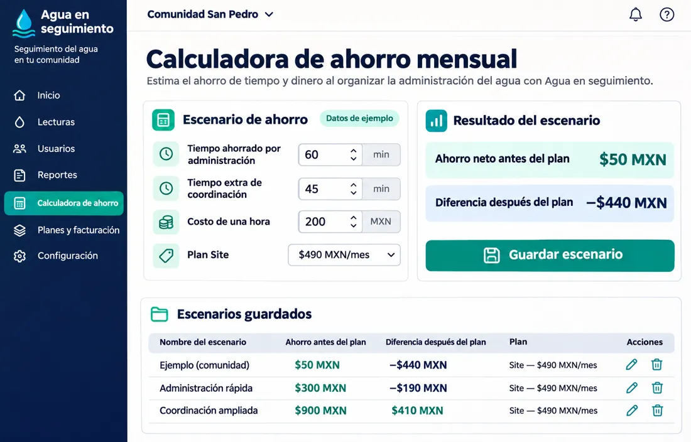
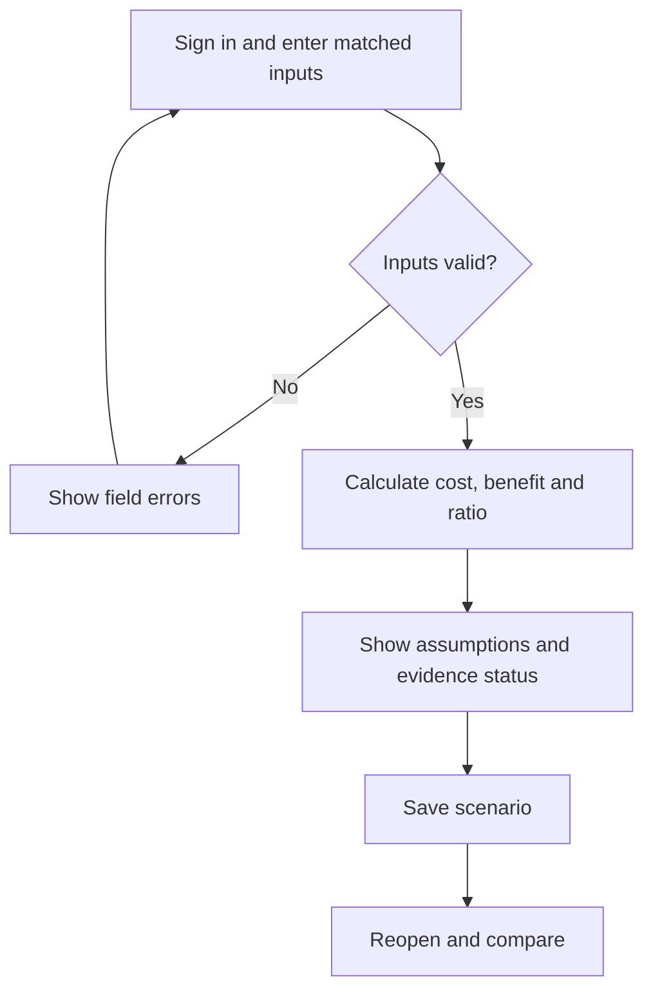
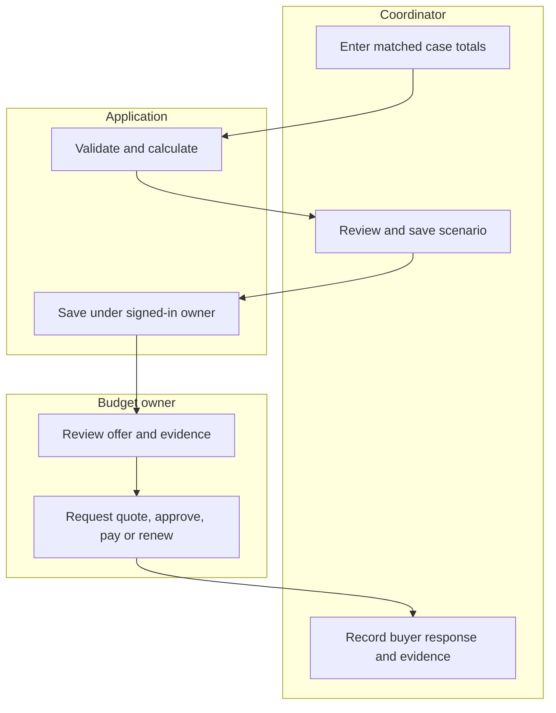

# Agua en seguimiento
## Week 14 · Pricing build packet

**Isabella Zevada Vázquez · Operator · Team 8**

**14 November 2026 · Pre-build specification**

### 1. Problem and exact user

A condominium coordinator tracks leaks across WhatsApp and Excel. The committee needs to decide whether paying **$490 MXN for one month** buys enough improvement over an organized version of that workflow. The comparison must include the time spent setting up, entering updates, and checking that repairs actually resolved the leak.

Laura, a synthetic 54-year-old coordinator who uses WhatsApp, reads slowly, and has little time, is the primary user. She enters and retrieves scenarios. The authorized condominium administrator or committee member controls the budget. The household reports whether the leak persists and is the only source that can confirm resolution.

### 2. Success before the module closes

At the venture's real domain, Laura can sign in with Google, compare the same cases and period under WhatsApp + Excel and Site, see the monthly costs and buyer benefit, and reopen a saved scenario after signing out and back in. Each scenario keeps its inputs, evidence labels, pricing assumptions and calculation version. The result shows both the $490 renewal threshold and the 10:1 course target with plain-language explanations. A scenario with hypothetical inputs stays labeled as hypothetical. Payment and pricing activity never change case status.

### 3. Offer and decision rules

| Plan | Monthly price | Scope |
| --- | --- | --- |
| Free | $0 MXN | Five active cases plus one overflow slot. A seventh report stays visible as in WhatsApp, with no assigned owner or follow-up date. |
| Site · pilot focus | $490 MXN | One month, one condominium, 25 active cases, 30 minutes of setup and 15 minutes of support. Migration of 20 existing cases is quoted separately. |
| Program · offer reference | $1,490 MXN | Three sites, 100 active cases total and a combined view. |

Fix the Site price and scope before the buyer conversation. Log quote requested, written approval, payment received and renewal as separate events with a date and source category. A quote request is an interest signal. For the five-case free trial, compare matched cases first. Use conservative assumptions for comparable additional cases and test those assumptions before projecting at full capacity.

| Measure | Calculation or interpretation |
| --- | --- |
| Monthly labor value before plan | Sum across roles of (baseline minutes − Site minutes) × hourly MXN ÷ 60. Include entry, follow-up and updates in both workflows. Use separate rates for administration and coordination. |
| Other verified buyer benefit | Optional, attributable MXN with a source and period. Count each benefit once. Evidence of a repair alone does not establish a monetary amount. |
| Total buyer cost for first month | $490 + buyer setup labor + separately approved charges. Recurring buyer cost excludes one-time charges and includes any recurring charges. Provider setup and support labor are tracked separately. |
| First-month buyer value | Monthly labor value + other verified buyer benefit − first-month buyer cost. Show the recurring equivalent separately when first-month costs differ. |
| Benefit-to-cost ratio | (Monthly labor value + other verified buyer benefit) ÷ total first-month buyer cost. Show “Not calculable” when the denominator is zero. Show progress to 10:1 separately. Result is an estimate when any input is hypothetical. |
| Renewal rule | Monthly buyer value before the plan must cover recurring buyer cost, with household verification maintained. Record observed evidence before recommending a paid renewal. |
| Provider cost | Track founder setup, support, and retry minutes × provider hourly rate, plus direct delivery costs. Show cost and contribution separately from buyer value. |

**Synthetic fixture.** At $200 MXN/hour for both roles, administration saves 60 minutes and coordination adds 45 minutes. Labor value is $50 MXN and the first-month balance is −$440 MXN when all additional costs are zero. The ratio is 0.10×. The fixture is a calculation check.

### 4. Evidence and the shadow clause

Payment buys service and access. Repair reports and functional checks retain their date and source. Verified closure requires household confirmation with its date and channel, a dated repair and functional check under suitable water supply, and no continuing-loss report. A contradictory household report reopens the case even if a technician previously marked the repair as successful. Preserve unresolved and paused cases as unverified. Store scenario totals independently from the case history.

For the pilot, track the share of material WhatsApp changes entered within two business hours and before action, decisions made with outdated information, minutes by role, and family-confirmed outcomes. Record “unknown” when evidence is missing.

### 5. Image-generated mockup

### 6. Feature flow

### 7. Benchmark

The strongest existing benchmark I found for the pricing feature is MaintainX's maintenance ROI calculator, which estimates gains from labor productivity and avoided downtime. Agua localizes that approach to one Mexican condominium by comparing its own WhatsApp + Excel baseline against a $490 MXN monthly pilot with attributable household evidence. [MaintainX ROI calculator](https://webflow.getmaintainx.com/roi-calculator)

### 8. Three-year view

In three years, administrators could compare follow-up costs and household-verified outcomes across sites. Coordinators could see which cases need action and keep their existing contact channel with households. Committees could use the same evidence to decide which sites to renew or expand.

### 9. Scope and architecture

This week covers matched workflow comparisons, saved scenarios and the Site pilot decision log. Deferred work includes checkout, invoicing, automated WhatsApp ingestion, bulk migration, Program rollups and AI-generated valuations.

| Layer | Existing stack and addition |
| --- | --- |
| Interface and hosting | Existing Next.js/React app on Vercel free tier. Add a Spanish pricing route and update the existing navigation. |
| Calculation | Shared deterministic JavaScript function. Validate in the UI and server. Store currency in cents and round only at documented calculation boundaries. |
| Identity and data | Supabase Google Auth and owner-scoped RLS for scenario and decision records, including write checks. Reuse the signed-in user's access token. |
| Validation | Reject invalid numbers, missing required inputs and mismatched periods. Bound minutes, rates and text length. Use fixed evidence categories and server-assigned ownership. |
| Security and demo | Use invented data labeled on screen. Keep secrets out of Git and configure server secrets in Vercel. Reuse the existing closure rules and avoid collecting household details in scenarios. |

### 10. Test and release plan

| Check | Expected result |
| --- | --- |
| Synthetic example | $50 before plan, −$440 after plan and 0.10×. |
| Cost and threshold boundaries | Different role rates, setup and migration change the expected totals. At equal benefit and cost the balance is $0 and the ratio is 1.00×. At $4,900 on $490 cost the ratio is 10.00×. |
| Invalid inputs and persistence | Reject negative raw minutes and rates, blank required fields and mismatched periods. Save and reload with the same inputs and outputs. |
| Privacy | Signed-out save is blocked. A second signed-in account cannot read or change another owner's scenario or decision events. |
| Shadow clause | A technician's favorable test and paid status leave verification pending until household confirmation. A later report of continued leakage reopens the case. |
| Mechanical pass | Use deployment 1 at the real domain. Record an observed defect, correction, commit, deployment 2 and retest. |
| Synthetic persona pass | In a fresh chat, show Laura each live screen in order. Ask her to compare, save and reopen a scenario and explain the result in her own words. Log her confusion and fix the worst issue. |

Capture the Packet commit before implementation. At session close, update DECISIONS.md with decisions and tomorrow's first move, then commit and push. Record the deployment URLs and test evidence. The Week 14 Crystal Ball Brief, final team ratification and real grading domain still need confirmation against the course materials.
