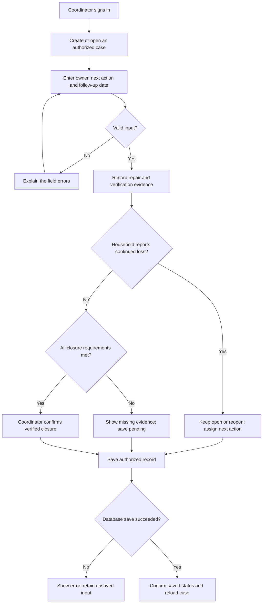
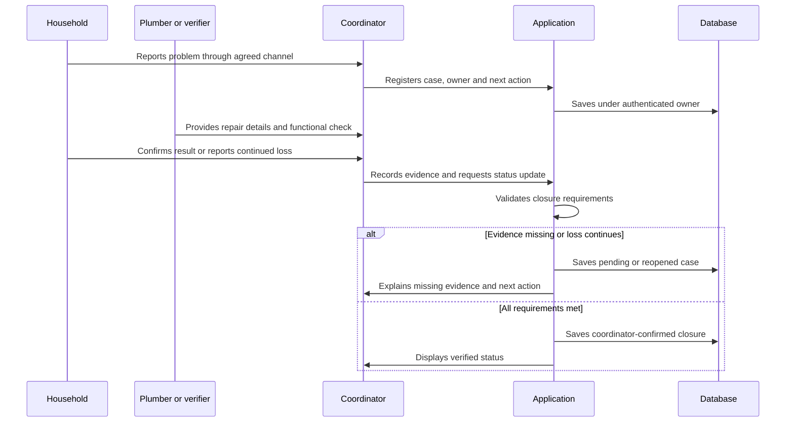

# Agua en seguimiento - Week 12 Build Packet

Owner: Isabella Zevada
Status: Pre-build plan
Related documents: CHARTER.md and PERSONAS.md

## 1. Problem in my words

A reported repair does not necessarily mean a household's
water-loss problem has been resolved. A coordinator needs
to know which cases remain pending, who is responsible,
what happens next and what evidence is missing.

We assume that some coordinators reconstruct this information
from messages, calls and spreadsheets. This assumption has
not yet been confirmed with a real coordinator.

## 2. Exact user

The primary user is a coordinator managing an initial set
of up to ten household leak cases in one area.

The household representative confirms whether the problem
continues through an agreed contact channel. The coordinator
records that confirmation. Household and plumber accounts
are outside the initial build.

Laura is a fictional coordinator used for synthetic testing.
She is not an interviewed customer.

## 3. Success before the module closes

An authenticated coordinator can:

1. Register a fictional case.
2. Assign a responsible person, next action and follow-up date.
3. Record completed repair work.
4. Record a functional check and household confirmation.
5. See which requirements are missing.
6. Save an incomplete verification without closing the case.
7. Close a case only when all closure requirements are met.
8. Reopen a case when the household reports continued loss.
9. Reload the page and retrieve the saved information.

The site must work at the venture's purchased domain.
Home, /product and /about must load.

Passing these checks demonstrates the software workflow,
not real-world repair success, adoption or water savings.

## 4. Image-generated mockup

The AI-generated dashboard image is stored in this docs folder.
It shows fictional cases and a repair awaiting household
confirmation.

The mockup includes:
- A case list with status, owner and next action.
- An amber verification-pending status.
- A visible explanation of missing confirmation.
- "Guardar pendiente" as the available action.
- A disabled "Cerrar como verificado" action.

Implementation corrections:
- Add a visible follow-up date.
- Limit navigation to the core case workflow.
- Do not implement the extra navigation shown in the image.
- Checkmarks must correspond to saved evidence, not just
  an unchecked claim becoming checked.

The image is a visual reference, not a working application.

## 5. My Method as the engine

Step 3 of my Method becomes the function that makes each
case's responsible person, pending action and required
verification visible, and keeps a reported repair pending
until verification evidence and household confirmation
are recorded.

The rule uses deterministic logic. It requires no AI model.

Closure requires:
- A dated repair record describing the work performed.
- A dated functional check with performer, method and result.
- Suitable water-supply conditions for a meaningful check.
- Household confirmation, including date and contact channel.
- No report that the loss continues.

Missing or inconclusive information keeps the case pending.
If the household cannot be reached, save the next contact
action; do not assume the repair worked.

## 6. Feature flow

## 7. Actor responsibilities

Household and provider communication is outside the app
in this build. The coordinator records its source and date.

## 8. Benchmark

Selected international benchmark:
Sydney Water's WaterFix Residential connects household
leak problems with qualified plumbing services and
defined repair coverage.

Source:
https://www.sydneywater.com.au/your-home/helping-you-save-water/waterfix-residential.html

Localization:
Agua en seguimiento focuses on a Spanish-language
coordination workflow for a small Mexican support program,
making responsibility, pending actions and closure evidence
explicit.

WaterFix is a relevant benchmark, not proven to be the
world's best solution. Its public description does not
establish how its internal case-management software works.

The practical alternative to beat is the coordinator's
current process, including a well-organized Excel sheet.

## 9. Three-year view

The product could become a reliable follow-up workspace
for small household water-support programs.
It would help coordinators preserve case history and
distinguish reported work from verified outcomes.
Expansion would depend on real demand, feasible funding
and evidence that the workflow improves on simpler tools.

## 10. Scope cut

Build one feature:
case registration and follow-up through verified closure.

Included:
- Google sign-in.
- Case list and detail view.
- Create and update case.
- Owner, next action and follow-up date.
- Repair and verification records.
- Missing-evidence explanations.
- Save, reload and reopen.
- Home, /product and /about.

Excluded:
- Sensor integration.
- AI diagnosis or generated repair advice.
- Payments and funding applications.
- Provider marketplace.
- Automatic messaging.
- Route optimization.
- Household or plumber portals.
- Water-savings predictions.
- Automatic closure.

## 11. Architecture and stack

| Layer | Planned choice | Responsibility |
| --- | --- | --- |
| Interface | Next.js / React | Spanish pages and case workflow |
| Styling | Tailwind CSS | Accessible responsive interface |
| Authentication | Supabase Auth with Google | Coordinator sign-in |
| Database | Supabase PostgreSQL | Persistent case records |
| Authorization | Row Level Security | Restrict records to their owner |
| Validation | Shared server-side rules | Reject invalid input and closure |
| Hosting | Vercel | Deploy the working application |
| Version control | GitHub | Source, documents and commit history |
| Domain | Venture-owned purchased domain | URL of record |

Use free service tiers. Domain purchase is a separate
assignment requirement. No account or domain setup is
claimed complete in this packet.

## 12. Minimum data

Each case stores:
- Internal ID and fictional household code.
- Authenticated coordinator owner ID.
- Brief problem description.
- Responsible person's name or role.
- Status.
- Next action and follow-up date.
- Repair description and completion date.
- Check performer, date, method, result and supply conditions.
- Household confirmation result, date and channel.
- Creation and update timestamps.
- Reopening reason when applicable.

Initial demos must not collect real addresses, phone
numbers, identification documents or bank information.
Use case codes H-001, H-002 and H-003.

Statuses:
reported, repair pending, verification pending,
verified resolved, referred and reopened.

A referred case is not counted as resolved.

## 13. Security floor

1. No secrets in source or GitHub. Deployment credentials
   belong in environment variables.
2. Require Google sign-in for stored case data.
3. Enable RLS on every user-data table. Validate ownership
   for reads, inserts and updates.
4. Validate input on the server and in the interface:
   required fields, valid dates, allowed status values,
   trimmed text and explicit length limits.
5. Use labeled fictional demo data only.

Suggested limits:
- Case code: 30 characters.
- Owner or responsible role: 100 characters.
- Problem description: 500 characters.
- Next action: 250 characters.
- Repair and verification notes: 1,000 characters each.

Do not trust a client-supplied "verified" status.
The server and database must enforce closure requirements.
Never display a successful save before persistence succeeds.

## 14. Blueprint conditions

1. Do not claim customer demand without a real recent case.
2. Distinguish reported, missing and verified information.
3. Compare complete tasks against existing alternatives.
4. Identify responsible people and external dependencies.
5. Preserve human decisions and provide reopening rules.
6. Shadow clause: never present simulated, predicted,
   reported or intermediate results as verified
   real-world success.

For this build, a repair record alone must never produce
a verified-closure label.

## 15. Test plan - planned, not completed

| Test | Expected behavior |
| --- | --- |
| Create a valid case | Record saves and reloads correctly |
| Missing owner or next action | Clear validation error |
| Whitespace-only required field | Rejected |
| Repair recorded, no check | Verification stays pending |
| Check inconclusive due to supply | Closure blocked |
| Household not reached | Save pending with next action |
| Household says loss continues | Closure blocked or case reopened |
| All evidence complete | Coordinator can close and save |
| Direct invalid closure request | Server/database rejects it |
| Another user's case ID | Read and update denied |
| Signed-out database request | Access denied |
| Failed save | Error shown; no false success |
| Refresh after update | Saved state remains |
| Mobile and keyboard use | Core actions remain accessible |

Mechanical pass:
Run the tests and document actual results, defects and fixes.
If a bug is found, fix it and redeploy. Do not invent a bug
or report a planned test as completed.

Synthetic persona pass:
Use Laura in a fresh chat and show screens in task order.
Ask her to find H-002, explain its status and save the case
while household confirmation is missing.
Log confusion, select the most important correction,
retest and distinguish simulation from real-user evidence.

## 16. Value hypothesis and measurement

Illustrative target:
20 minutes to identify pending cases, owners and next actions
with a baseline workflow versus 2 minutes with the prototype.

These are hypothetical figures, not measured results.

Compare equivalent tasks at comparable accuracy. Include
data entry and updates, missed cases and incorrect closures.
If Excel performs similarly, improve the sheet rather than
claiming an unsupported advantage.

North Star:
Verified resolved cases divided by all accepted cases in
a defined intake cohort, measured at a stated cutoff.
Pending, referred and reopened cases remain visible.
No real service outcome has been measured.

## 17. Implementation and deployment plan

1. Commit charter, personas, packet and generated mockup
   before implementation.
2. Commit the site skeleton and shared visual components.
3. Commit authentication, schema and RLS.
4. Commit the case workflow and closure rules.
5. Commit documented test fixes and usability corrections.

Deploy at least twice:
- First functional deployment for testing.
- Updated deployment after actual corrections.

Record real commit hashes, deployment URLs and dates.
Connect and test the venture's purchased domain.
Do not reconstruct or backdate development evidence.

## 18. Session Close and evidence

At the end of every build session:
- Update docs/DECISIONS.md.
- Record decisions, remaining limitations and next action.
- Update the prompt/development log.
- Commit and push.

Final deliverables:
- Live venture-domain URL.
- GitHub repository link.
- Demo video with the final 30-second reflection.
- PACKET_IsabellaZevada.pdf.
- PERSONA_IsabellaZevada.pdf with actual synthetic-test log.
- BUILDCHAT_IsabellaZevada.pdf with the development exchange.

This packet is the pre-build plan. Test results, deployment
evidence and real-user findings must be added when obtained.
