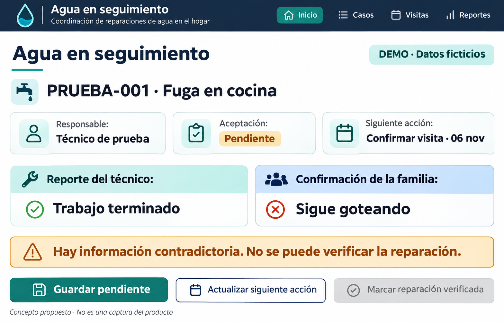
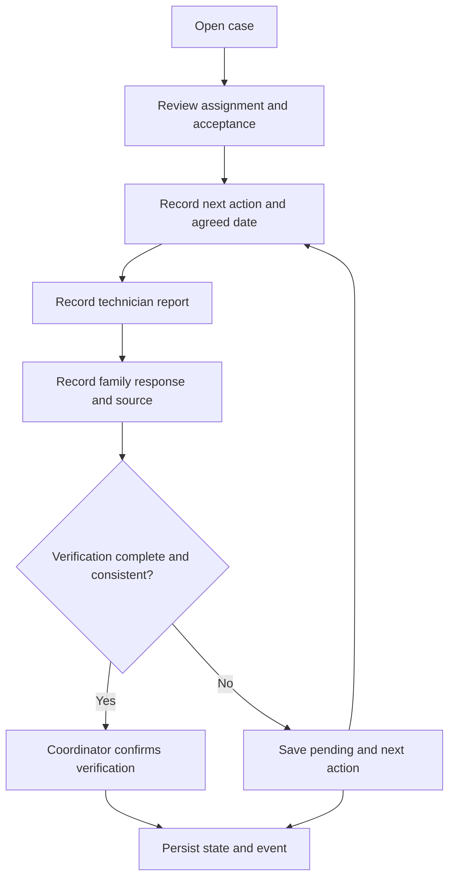
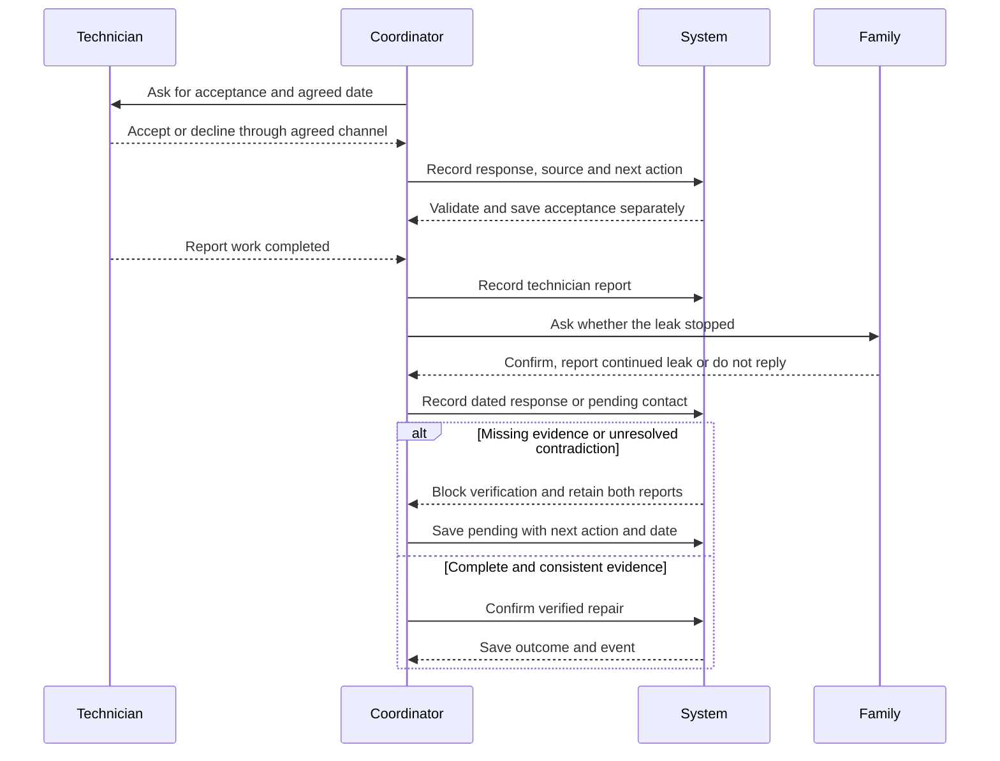

# Agua en seguimiento
## BUSINESS BENDING · WEEK 13 · REAL HUMANS
Isabella Zevada | Universidad Iberoamericana | November 4, 2026

**Pre-implementation design packet.** Proposed behavior, not evidence of a completed build. Current domain, repository, stack inventory and Week 13 team Blueprint remain to be supplied. Reconcile this packet with those sources before implementation; preserve the existing stack. No user sessions, measured gains, commits or deployments are claimed here.

## 1. Problem in my words
I want to help a coordinator know who has accepted a household-repair task, what happens next and by when. Updates can remain in separate conversations while a dashboard appears current. My hypothesis is that explicit acceptance and a small update workflow reduce omissions enough to justify maintaining the record. Organizing a case does not supply technicians, repair funding or proof that a leak has stopped.

## 2. Exact user and task
The primary user is a coordinator in a small Mexican household-support program who receives reports, coordinates technicians and follows up with families through agreed channels. Laura, 54, is a synthetic usability persona who uses WhatsApp and basic apps, reads slowly and has little time; she is not a real research participant. Technicians and families communicate through their agreed channels; in this slice the coordinator manually records their responses and sources. Neither needs a separate account. Record acceptance as reported by the technician, never inferred from assignment.

## 3. Success definition
Before the module closes, a coordinator can open a fictional case, identify the assigned person and acceptance state, record a next action with an agreed date, save an incomplete verification as pending, and distinguish technician completion from dated family confirmation. A contradictory family response blocks verification. Changes persist across reloads, and a minimal event log records successful changes and blocked verification attempts.

Mechanical acceptance requires every critical state-rule and access-control test below to pass. The proposed usability target is at least four of five participants completing the core tasks without coaching or a false verified closure; this is a pilot target, not a result or a population estimate. Compare accuracy, time and total update effort against an organized Excel file. Do not claim a 10:1 gain without measurement.

## 4. Image-generated mockup

Concept generated for this packet, not a screenshot of the current product. Spanish interface, large text, separate technician and family reports, visible contradiction, Save pending and a disabled verification action. Exact state rules below take precedence over illustrative image text.

## 5. Feature flow — Mermaid

## 6. Actor swimlanes — Mermaid
The sequence diagram uses one lane per actor. Messages from the technician and family occur through existing channels; there is no automatic WhatsApp integration.

## 7. Benchmark line
The strongest existing solution I would benchmark for this workflow is MaintainX, whose documented request portals and external work orders address maintenance requests and outside participants [1, 2]; this is my benchmark choice, not an objective worldwide ranking. Mine proposes a small Spanish-language workflow for a household-support coordinator, with explicit acceptance and family-confirmed repair outcomes, whose local value must be tested rather than assumed unique.

Microsoft Lists is a second configuration benchmark: its Issue tracker template and notification rules challenge the need for a separate app [3, 4]. An organized Excel file is the immediate experimental baseline, not an assumed inferior option. Product documentation establishes capabilities, not adoption in the target organization; account access, cost and configuration effort still need checking.

## 8. Long view — light charter
In three years, if this slice proves useful, Agua en seguimiento could become a lightweight follow-up service for small household-support programs, connecting each pending action to accepted responsibility and a verifiable outcome. Families would keep an agreed familiar contact channel while coordinators retain clear sources, dates and a traceable history. Expansion would depend on demonstrated reductions in omissions and sustainable update effort, and adapting an existing tool would remain a valid outcome.

## 9. Scope cut and shadow clause
Build only a coordinator case list/detail, explicit acceptance, next action/date, separate repair evidence, save-pending behavior and a minimal event log. Exclude automatic WhatsApp ingestion, AI-generated decisions, predictive scores, sensors, payments, technician dispatch optimization, a family portal and public personal records. Use invented demo data with a persistent label. No AI is needed for the proposed state rules; label any later simulated output on screen.

The shadow is mistaking an orderly record for an actual improvement at home. Separate follow-up state (reported, in follow-up, paused, archived) from repair outcome (not verified, verification pending, verified). Pausing or archiving never creates a verified success. Verification requires a technician completion report, dated family confirmation through an agreed channel and no unresolved contradiction. Preserve contrary reports; a later continued-leak report reopens verification rather than overwriting history. Do not impose a second-person check without evidence that its benefit justifies the workload. Final alignment with the team's actual Week 13 Blueprint is pending.

## 10. Architecture and stack
| Layer | Proposed responsibility | Status / constraint |
|---|---|---|
| Current frontend | Spanish case list/detail and validated forms | Reuse existing framework; inventory pending |
| Current hosting + domain | Serve the existing venture URL over HTTPS | Preserve real domain of record; URL pending |
| Existing persistence | Save cases, evidence and history | Inspect implementation before choosing changes |
| Supabase Auth, if storing personal information | Google sign-in and authenticated session | Required by course; configuration and free availability must be verified |
| Supabase tables, if used | Cases, evidence and events with owner-scoped RLS | No user-data table without RLS; verify with two accounts |
| Mutation handler | Validate, authorize and enforce verification rules | Enforce at persistence boundary, not only button state |
| Analytics | Minimal persisted event log | No third-party paid analytics required |
| GitHub | Packet, decisions, history and source | Repository URL pending; no implementation yet |

Logical records: case (ID, owner, assignment, acceptance state, next action/date, follow-up state, repair outcome); evidence (case ID, report type, response, contact date, channel/source, recorded-by, timestamp, superseded-reference); event (case ID, owner, event name, timestamp, reason code). Keep a minimal auditable trail; no exact addresses, phone numbers or copied messages in the demo or analytics. Each user owns their cases for this slice; organization-wide sharing is out of scope. Store a mutation and its corresponding audit event together, or report failure instead of claiming success.

## 11. Security floor and validation
No secrets in source, browser bundles, screenshots or Git history. Private service credentials remain server-side in deployment environment settings; never ship a service-role key. If personal data is stored, require Google sign-in before record access, enforce owner access and RLS on every user-data table, and check account A cannot read or change account B's cases, evidence or events. Do not introduce real household data to the public demo.

Validate required fields after trimming, acceptance/outcome values against enums, case IDs against the allowed format and dates as real calendar dates. Proposed limits: title 120 characters, role/alias 80, next action 240, evidence note 500; reject oversized, blank-required or malformed values at both form and persistence boundary. Acceptance needs a source and contact date. Verified repair needs dated positive family confirmation, technician completion and no unresolved contradiction. Display user content as text; do not render raw HTML. Show a clear retry state after a failed save and avoid duplicate records on repeated submission. Verify the actual implementation before marking any floor item passed.

## 12. Analytics and feedback mechanism
Record case_opened, acceptance_recorded, next_action_updated, technician_report_recorded, family_response_recorded, verification_saved_pending, verification_blocked and repair_verified. Log only case code, authorized owner ID, timestamp and a categorical reason such as missing_confirmation or contradictory_reports. Do not put evidence text or contact details into analytics. Events describe interactions, not repair truth or adoption. Keep a separate consented test sheet with participant codes, task times, coaching, errors and comments; access and retention must be agreed before collecting it.

## 13. Mechanical test plan — execute after build
| ID | Test | Required result |
|---|---|---|
| M1 | Assign a technician without acceptance | Show pending; never display accepted |
| M2 | Record acceptance and reload | Acceptance, source and contact date persist |
| M3 | Save next action without a date; submit blank/oversized content | Reject with a specific field message |
| M4 | Technician says finished; family has not answered | Save pending; verification blocked |
| M5 | Technician says finished; family says still leaking | Preserve both reports; verification blocked |
| M6 | Save positive dated confirmation with completion and no contradiction | Explicit verification succeeds and is logged |
| M7 | Pause/archive an unverified case | Outcome remains unverified; no success inflation |
| M8 | Report a continued leak after verification | Reopen verification; retain earlier evidence |
| M9 | Disconnect during save and submit twice | No false success or duplicate mutation |
| M10 | Read/change another account's case/evidence/events directly | Denied; unauthorized session also denied |
| M11 | Send invalid values directly to persistence boundary | Reject even if UI checks are bypassed |
| M12 | Open domain on mobile and desktop after deploy | Core path loads; labels and controls usable |

Run the suite, document at least one actual defect with expected/observed behavior and evidence, fix it, repeat the affected tests and redeploy. All results are currently pending; do not invent a bug to fill the log. Record deployment URLs/times and commits when they exist.

## 14. Synthetic and real-user tests
Synthetic pass: open a fresh chat as Laura; supply current screenshots in order and ask her to attempt the task aloud without coaching. Ask her to identify acceptance, find the next action/date, handle a continued leak and save incomplete verification. Log each hesitation with screen, quote, severity and proposed fix. Correct the worst observed confusion, retest and capture actual before/after evidence; none is yet claimed.

Real pass: recruit five people who receive reports or coordinate maintenance, at least three strangers. Prioritize household-support coordinators; label administrators or maintenance coordinators as adjacent profiles. Obtain consent, use fictional cases and avoid recording identifying details. Give equivalent cases in the prototype and organized Excel, alternating which comes first. Measure correct acceptance/next-action/date identification, contradictions detected, false closures, task time, coaching and total entry/update effort. At an update moment agreed by each participant, check whether a new change was recorded before they make a decision; if this follow-up is unavailable, report it as missing.

Pilot warning rule: if at least three of five fail to record relevant changes by their agreed moment and then act on stale information, simplify and test again; persistent failure challenges a separate platform. If Excel performs similarly or better at equal accuracy and lower effort, consider adaptation. Five favorable opinions are not proof; no willingness-to-pay or 10:1 result is established.

## 15. Build sequence and Session Close
Proposed commits: (1) packet + generated mockup + Mermaid sources before feature code; (2) acceptance + next-action validation; (3) evidence separation + verification guard; (4) minimal events + security checks; (5) actual bug fix + test evidence + decision update. Make additional commits as needed, and record actual hashes; this is a plan, not a completed history. Deploy 1 follows a testable implementation; deploy 2 follows a documented fix and retest. Use only free services after verifying the actual account limits.

End every working session by updating DECISIONS.md with decisions and evidence, unresolved issues and tomorrow's first move, then commit and push. Preserve this packet's pre-code commit as evidence. Final submission: real domain URL, GitHub link, DEMO_IsabellaZevada.mp4 (3 minutes plus 30-second reflection), PACKET_IsabellaZevada.pdf, PERSONA_IsabellaZevada.pdf and BUILDCHAT_IsabellaZevada.pdf with the actual development conversation.

## 16. Before implementation
Confirm the current live domain, repository and stack; reconcile the team's Week 13 Blueprint and shadow conditions; then turn this packet into a precise implementation prompt. A generated mockup is design evidence only. User tests, security checks, bug findings, commits, deployments and adoption evidence remain pending.

## Sources
Provided: BRIEF_13_IsabellaZevada(1).pdf and Week 13 Business Bending assignment. Official documentation checked November 4, 2026:

1. MaintainX, About Request Portals: https://help.getmaintainx.com/set-up-a-request-portal
2. MaintainX, External Work Orders: https://help.getmaintainx.com/external-work-orders
3. Microsoft Support, List templates in Microsoft 365: https://support.microsoft.com/en-gb/sharepoint/lists/data-and-lists/list-templates-in-microsoft-365?nochrome=true
4. Microsoft Support, Create a rule to automate a list or library: https://support.microsoft.com/en-us/sharepoint/lists/documents-and-library/create-a-rule-to-automate-a-list-or-library
